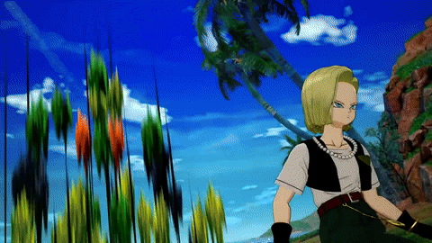
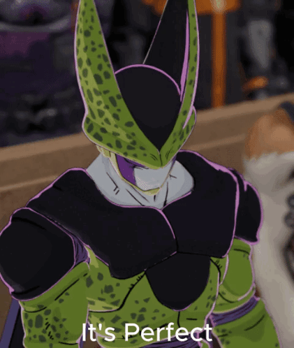
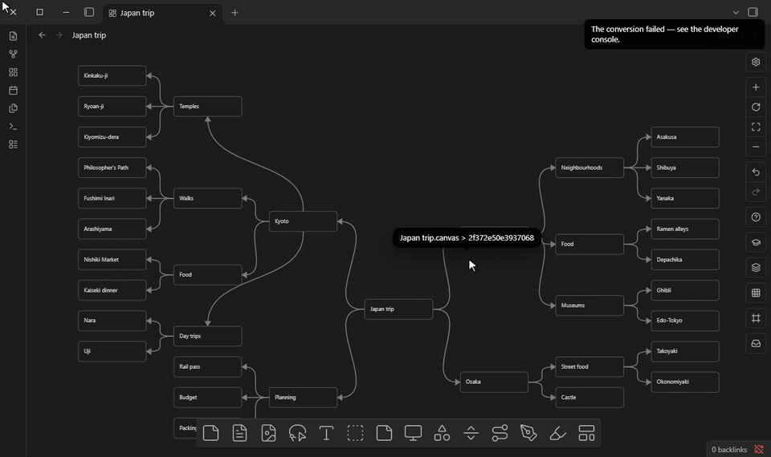

# Overpowered Canvas

## Plugins absorbed

## Plugins absorbed

In addition to have many features on it's own , the plugin absorbed various other plugins:



Advanced Canvas,
Canvas Mindmap,
CardNote,
Arbor, and far more



## Before anything else, I want to thank

Hajime No Ippo , hopefully this plugin grows big enough so someone works in Netflix notices this and fund the series:


Also an additional thanks to thanderhall | Frog Grand Master for testing the plugin along with his medicine studies , many bugs and additional features were implemented thanks to him.

## The plugin includes interactive tutorials for all of it's features.

## You don't have to read any of the mentioned below, better spend this time on the tutorials.

An Obsidian plugin that turns the core Canvas into a full whiteboard with ton of features.

Every feature is a **module** you can switch off in the settings. A disabled module leaves no
patches, listeners or styling behind.

## Features

**Right-click menu style** — text size, spacing, width, corners, icons, shadow and colors (light and
dark mode) of the menus of canvases, with a live preview; right-click and ⋮ menus everywhere when
Customize the bars applies them to the whole vault.

**Emoji** — a bottom-bar button with every emoji (search in English and the plugin's language,
categories, recently used, skin tones; bundled, works offline): into the card you're editing at
the cursor, at the end of the selected card, or into a new card.

**Cards and edges** — flowchart and basic shapes on cards, border styles, start/center/end and
top/middle/bottom text alignment (new cards can be centered automatically), a text size per card
(also while editing and in the column view), cards that grow sideways or downwards as you type
or fit their text up to a maximum width (you choose the mode new cards start in; a shaped card
grows enough to keep its text inside the outline), new cards that snap to the grid, default and
minimum card sizes, labels and line widths that keep their size at every zoom, a group made
straight from the bottom bar (click or drag) without selecting cards first, layers like in image editors (a Layers panel to create,
rename, reorder, hide, lock and delete them; new items go to the active layer; move the
selection to a layer or one layer up or down), custom colors from CSS, card templates in the bottom bar, empty groups, card
content at any zoom level (always, below your own zoom, or per card), text that doesn't jump between reading and editing; edge line styles and
arrowheads, routing (curved, straight, right-angle, A\* around cards), floating edge ends, flip /
highlight / select connected edges, draggable bend points and labels.

**Drawing** — pen, pencil, marker and highlighter with pressure and tilt (perfect-freehand),
palm rejection (a resting palm never draws or moves the board under the pen, also with
Scribble on), palm navigation and a drag button, the pen's eraser end, whole-stroke and partial eraser, lasso to
move / scale / delete / lock strokes, recent colors, smoothing, a size slider with an exact
number box, and shape recognition (hold at the end of a stroke). Every stroke is its own
drawing; resize a drawing's card and its strokes scale with it. Marks drawn on a card stick to it: they move, copy and delete with the card.
Strokes picked with the lasso can be put into a card (**Put into a card**: a new card made
around them, or the card under them) and taken out again; a card made for a drawing stretches
it when resized, and shows it in the column view and the table of contents.
Highlight words inside a card without editing it, or color their letters (swipe or tap with a pen
or the mouse; the highlight or color goes into the card's text, so it shows in every view and in
Markdown; **Neutral** writes Obsidian's own `==highlight==` in your theme's color). Free lines and arrows whose ends stick to cards and that
keep the corners you draw; bend points keep the route's shape when cards move (square routes stay
square), drawn above the cards (or under them). Standalone shapes with
fill, outline, opacity and rotation. Sticky notes in any color (the last 10 custom colors are
kept) whose text shrinks to fit. Floating text without a card around it. Infinite
lines at any angle (turn them live with a slider from the selection toolbar) with their own
color and thickness. Non-destructive image crop.
Lock items in place. Smart groups (Ctrl/Cmd+G, like in other whiteboard apps): cards that
select and move as one with no frame around them; double-click (or double-tap with a finger or
pen) a card to work on it alone, copies form their own group.

**Mind maps** — Tab / Enter to add children and siblings (a sibling goes right after its card),
a child straight in a flowchart shape (process, terminal, decision or input/output) with a
modifier and an arrow key, or from the card menu (_Add child card as a shape_),
drag a card onto another card's "Add as child" / "Add as sibling" targets to move it with its
branch (the view follows dropped note blocks to the middle of the screen), Alt+arrows to move
between cards, walk through a map with the arrow keys at your zoom (or with on-screen arrows on
touch screens) without making slides — Right into the children, Left to the parent, Up and Down
along the siblings, wherever the cards sit (groups with arrows are stops too). No keyboard needed:
tap the empty board around the card, or the small arrows beside it, to move that way. The column
view shows the same walk as columns, one page at a time: the parents on the left, the card and its
siblings in the middle, its children on the right; groups are cards whose children are what they
hold. Add children and siblings there (+ buttons, Tab, Enter), edit cards, highlight or color words
and write on cards shown at their exact board layout, resizing a card right there to make room
for handwriting. The same view also runs top to bottom (the root on top, each level a row below
it), and cards wider than the way down are cut where the next level starts. The table of contents
shows a card's children together as cells of a grid (arrows go into a cell's own grid, a back
button goes up): a simple grid of N cells per row, or a free arrangement where cells dragged
beside or below each other form colored cell groups (with sub-groups inside them, your own colors,
thickness, line and corners per group, and a lock against moving them by accident), saved with the canvas. The pen, highlighter and text
color work on the cells too, into the same ink and marks as on the board. Handwriting stays smooth on boards with thousands of strokes; the drawing
bar turns pen writing into text cards (the device's own handwriting recognition), cards can show
their text in a handwriting font, and a drawing can be embedded in a note as a picture that follows
it when it changes. A canvas can also switch to fixed-size pages (A3, A4, A5, Letter, Legal or a
size of its own, portrait or landscape) that grow as you write and export to PDF, one page per sheet. Also
collapsible branches with child counts, and automatic layout that keeps the order the cards show
on the board (mind map in any direction,
collision-free radial that respects every card's size, balanced, layered flowchart, grid) as one
animated undo step; groups move as rigid blocks (also when a dropped card re-arranges the map), a
group around the whole map grows to hold it, and every arrow gets the sides of its shortest path
that passes under no card and crosses no other arrow (or bends around the cards when none does).



**Pages** — split a huge map into pages of the same canvas: _Move branch to a new page_ takes
everything below a card to a page of its own; the card stays in the map and it and the page's
first card link to each other. One page shows at a time in each tab (two tabs can show two pages),
a bar at the top shows where you are, and a pages index in the left sidebar lists them as a tree
(a page's icon folds the pages under it). Walking through the map crosses pages, Canvas → Markdown
writes pages as nested headings (nested bullets past the sixth level) or a note with pages, with
the links between a card and its page at the end of their lines, and a page can be brought back into the map (from its first card,
the card it comes from, the pages index or the command palette). Or move a branch to
another spot of the same page, linked the same way. Without the plugin the pages simply sit side
by side on the board.

**Text pages** — a second view of the same canvas, for studying in text: each page reads as an
outline (a map's root is a heading, the rest nested bullets, every other map on the page gets its
own heading), one page at a time instead of one endless note. The bar, the pages index and the
links between pages work inside the view. Edit a card's text from there, or export a PDF with one
PDF page per page and working links. It doesn't replace Canvas → Markdown, which still writes a
standard note.

**Auto-link** — finds the titles and aliases of your notes and canvases mentioned in canvas cards
(and in notes, if you want) and turns them into real `[[links]]`, so the graph and the backlinks
show the connection, not just a link drawn on top of the text. The text you read stays the same
(`[[Title|what you wrote]]`). You see the list before anything is written, the last run can be
undone, and a setting links each card when you finish editing it.

**Vault integration** — canvases get properties, tags, aliases and outgoing links in Obsidian's
metadata cache; edges from frontmatter links; links and embeds to a single card
(`[[file.canvas#card-id]]`); search inside a canvas (Ctrl/Cmd+F); read-only options; an info
button that edits a canvas' properties (tags, aliases, `cssclasses`, which style the canvas view);
PNG or SVG export of the whole canvas or the selection, with a transparent background, privacy
mode or a watermark. Canvases and notes open again where you left them (a canvas on the same page,
place and zoom, a note at the same place), after following a link and coming back, after closing
the file and after restarting Obsidian; a link to a card or a heading still goes there.

**Interaction and navigation** — a lasso that selects anything on the canvas (cards, groups,
edges, ink strokes) and stays on: press inside the selection to move it, and once a pen has
been used, fingers move and zoom the board; on touch screens a selection moves right away,
without a long press; cut in one undo step and paste under the pointer, with Cut / Copy / Paste
buttons on tablets; coloring several cards colors the edges between them; presentations along edges or through frames
(click a slide's name to hide or show its frame), portals into
other canvases, collapsible groups, focus mode, move a selection to a new canvas, PDF pages as
cards for annotation, custom style attributes from CSS snippets, a public events API, a minimap,
a frames panel to search, reorder and present the groups of a canvas, a line grid behind the
content (a line every N dots), an adjustable selection toolbar size (separately for computers
and phones; on phones the card bar joins the controls bar), every canvas action (create cards,
select, delete, duplicate, group, nudge, zoom) as a command you can give a hotkey, and
thirty-five hands-on tutorials (at the top of the settings and in the canvas
controls). Each tutorial opens a temporary practice board with a coach panel: small tasks that
tick themselves off as you do them, a "Show me" button that does each task live on the board, and
highlights on the controls involved. The board (and any practice notes it uses) is deleted when the tutorial closes. At the top of the settings you choose the vault folder for the plugin's own files (note data and
tutorial practice boards); Apply moves the files already there. **Debug mode** (off by default) shows
an on-screen message for every press on a page-navigation control and every page change, for
checking problems on tablets and phones. **Diagnostics** (also off by default) keeps a debug log of
the plugin's errors and input that you can copy or save to a note on any device (optionally kept
across restarts), and has a report of the canvas internals, the list of active patches and a
pan/zoom benchmark. The settings page has its own search box and collapsible sections, a plain-language
explanation under every setting, and every module and option also shows up in Obsidian's
settings search. A double-click on the empty canvas creates a card at a speed you choose
(fast, regular, slow or your own); dragging never creates one.

**Data features** — board templates (your own, plus Kanban, SWOT, Retrospective, Weekly plan,
Mind map and Flowchart), kanban columns bound to a frontmatter property with two-way sync
(rules: [docs/KANBAN.md](docs/KANBAN.md)), and query groups that fill themselves with notes
matching tags, folders, properties or links. Drag a block from a note onto a canvas (hold a line
with the mouse or grab its handle; on a touch screen, tap the line and drag its handle): a bullet with its children, a heading with its section or a paragraph
becomes a card under the pointer, or a linked child or sibling of the card you drop it on;
inbox mode sends clicked blocks into a named group. The handle shows while a canvas is open
beside the note (a long press keeps selecting text, and notes on phones are left alone unless you
turn this on), and can be an emoji or an image of your own, cropped to a circle or a square.

**Canvas ⇄ Markdown** — copy a mind map (or any connected cards) as a Markdown outline; paste an
outline onto the board, insert a note, or convert a note card to get a laid-out mind map; and
switch a whole canvas to a normal Markdown note and back with one command. The note is a readable
outline (one section per map, groups as headings, links and block references untouched) and
nothing else: positions, styles, edges and drawings are kept in a separate data file (or, if you
prefer, in a hidden section of the note). Edit the note by hand or with an
assistant, switch back, and cards keep their place and look while new lines become new cards
([docs/canvas-markdown-summary.md](docs/canvas-markdown-summary.md)).

**Languages and right-to-left** — the UI is available in English, Chinese (Mandarin), Japanese,
Hindi and Russian. A canvas can be right-to-left (globally or per canvas): mind maps grow to the left,
templates and frames run right to left, menus and panels mirror — or, in "text only" mode, only
the text turns right-to-left and the canvas UI stays as it is. Card text takes its direction per
paragraph (also while typing), so right-to-left and left-to-right text mix naturally; it can also be fixed per
card.

**Writing in notes** — in notes and canvas text cards, Tab writes a paragraph (first-line) indent
at the cursor instead of indenting the whole line (Shift+Tab removes it), made of em spaces so it looks the same in Live Preview, Source mode and
Reading mode and never becomes a code block; lists, tables and code keep their Tab (off until you
turn it on). Give one note its own font size with a `font-size` property or the Set / Increase /
Decrease / Reset commands; the size is identical in editing and reading, on desktop and mobile.

**Review flowchart** — learn flowcharts by heart. Put a chart in a group named `toreview` (or tag a
canvas `#toreview`; both names are settings), open the Review flowchart window from the side bar
and fill the chart in from memory, with its own shapes or as plain squares. Or choose **Answers:
Drag**: the texts of all the cards are shown mixed up below the chart, and each one is dragged
(mouse, finger or pen, or tap an answer and then a card) onto the card where it belongs. Submit
shows what was right next to the right answers, then Again / Hard / Good / Easy schedules the next review (FSRS).
Every chart shows how many reviews it had, the last one and when the next one is due; it can be
renamed and searched. A chart that changes starts over. The data is kept in a note in the plugin's
files folder, so sync plugins carry it between devices. A tutorial also explains what every
flowchart shape means.

**Large canvases** — below a zoom threshold, canvases with hundreds of cards switch to a
level-of-detail renderer: ~90 fps instead of ~9 fps on a 1,000-card stress canvas, with cards
still clickable ([docs/BENCHMARKS.md](docs/BENCHMARKS.md)).

## Keys inside a canvas

| Key                                   | Action                                                    |
| ------------------------------------- | --------------------------------------------------------- |
| P                                     | Drawing mode on/off (Esc leaves it)                       |
| L                                     | Lasso on/off (Esc leaves it)                              |
| H                                     | Highlight words in cards on/off (Esc leaves it)           |
| M                                     | Minimap on/off                                            |
| Ctrl/Cmd+F                            | Search the canvas                                         |
| Ctrl/Cmd+G / Ctrl/Cmd+Shift+G         | Smart group / ungroup (nothing to group: graph view)      |
| Tab                                   | Mind map: add a child (on a sticky note: the next sticky) |
| Enter                                 | Mind map: add a sibling                                   |
| Alt+Arrows                            | Move between connected cards                              |
| Ctrl/Cmd+Arrows                       | Add a card (or sticky) in that direction                  |
| Ctrl/Cmd+Shift+Arrows                 | Add a child in that direction                             |
| Shift+Arrows                          | Add a child in that direction as input/output             |
| Alt+Shift+Arrows                      | … as a process (rectangle)                                |
| Ctrl/Cmd+Alt+Arrows                   | … as a terminal (rounded)                                 |
| Ctrl/Cmd+Alt+Shift+Arrows             | … as a decision (diamond)                                 |
| → / Space / PageDown, ← / PageUp, Esc | Presentations                                             |
| Arrows, + / −, Home, Esc              | Walking through a map: child, parent, siblings; zoom      |

These are the defaults. Every key can be changed, switched off or given a second key in the
**Shortcuts** window (the **?** button of a canvas' side bar, the command palette, or the top of the
plugin settings): search by action or key, record a new key, conflicts with other shortcuts and
Obsidian hotkeys are pointed out, and the plugin's command hotkeys can be edited there too (they
stay in Obsidian's own Hotkeys).

The bottom bar, the side bar and the popup over a selection are yours to arrange: take off any
button, drag buttons into the order you like, and add a button for any command, from this plugin, the app or other plugins (_Customize
the bars_). Images (JPG, PNG…) get a popup of their own, arranged separately from the one over cards.
The right-click menu and the ⋮ menu are there too: switch off the items you don't use, in canvases
only or (one switch per menu) everywhere in Obsidian.

Every toolbar action is also in the command palette ("Selection: …"), so you can assign your
own hotkeys to any of them.

## Install

The plugin is not in the community catalog. Download `main.js`, `manifest.json` and
`styles.css` from the [latest release](https://github.com/kfirgumay2005-hash/Overpowered-Canvas/releases/latest)
(or install it with [BRAT](https://github.com/TfTHacker/obsidian42-brat)). To build from source:

```sh
npm install
npm run build        # type-check + bundle → main.js, styles.css
```

Copy `main.js`, `manifest.json` and `styles.css` into `<vault>/.obsidian/plugins/overpoweredcanvas/`
and enable _Overpowered Canvas_ under _Settings → Community plugins_. Requires Obsidian 1.14 or
newer; works on desktop and mobile.

If Advanced Canvas or Canvas MindMap is installed, the plugin offers to switch off its own
overlapping modules. Existing Advanced Canvas data in your files is left untouched.

## Data format

Everything is stored inside the canvas file under a namespaced `x-opc` key on the root, nodes
and edges ([docs/SCHEMA.md](docs/SCHEMA.md)). Shapes, stickies, lines and drawings are ordinary
`text` nodes, colors use the standard `color` field, and unknown properties are always
preserved — so files stay valid JSON Canvas 1.0 and open in vanilla Obsidian and other apps.
The schema is versioned, with tested migrations.

## Development

| Command          |                                        |
| ---------------- | -------------------------------------- |
| `npm run dev`    | Rebuild on change                      |
| `npm run build`  | Type-check and production build        |
| `npm test`       | Unit tests (vitest) for all pure logic |
| `npm run stress` | Generate the 1,000-card stress canvas  |

Docs: [DEV](docs/DEV.md) (architecture and module API) · [INTERNALS](docs/INTERNALS.md) (the
Obsidian canvas internals the plugin relies on) · [SCHEMA](docs/SCHEMA.md) · [EVENTS](docs/EVENTS.md)
(public events for other plugins) · [TESTING](docs/TESTING.md) (manual test steps per phase) ·
[BENCHMARKS](docs/BENCHMARKS.md) · [KANBAN](docs/KANBAN.md).

## Third-party code

Bundled, unmodified: [elkjs](https://github.com/kieler/elkjs) (EPL-2.0),
[monkey-around](https://github.com/pjeby/monkey-around) (ISC) and
[perfect-freehand](https://github.com/steveruizok/perfect-freehand) (MIT). See
[THIRD_PARTY_NOTICES.md](THIRD_PARTY_NOTICES.md).
